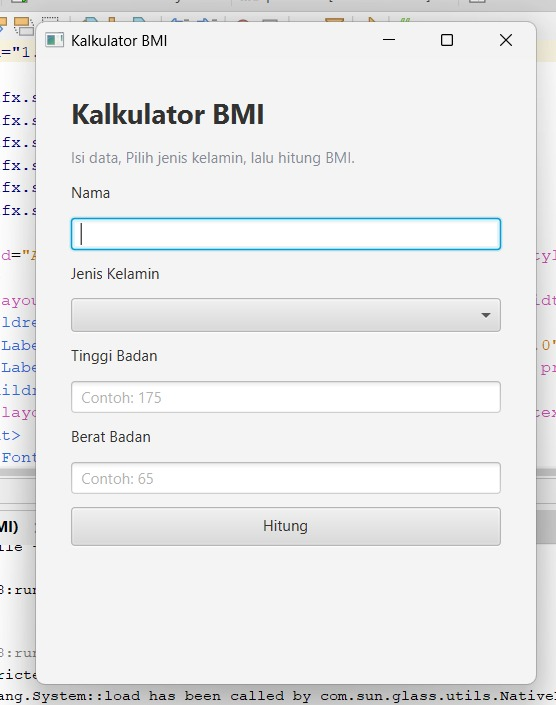

# Kalkulator-BMI - BMI Calculator

Aplikasi kalkulator Indeks Massa Tubuh (Body Mass Index/BMI) berbasis JavaFX.

## Deskripsi

Kalkulator-BMI merupakan aplikasi desktop sederhana untuk menghitung BMI berdasarkan nama, jenis kelamin, berat, dan tinggi badan pengguna. Aplikasi ini dibuat menggunakan Java, JavaFX, FXML, dan Maven.

## Tampilan Aplikasi

Berikut adalah contoh dari tampilan aplikasi Kalkulator BMI:

### 1. Tampilan Utama (Input Data)
<p align="center">
  
</p>

### 2. Hasil Perhitungan BMI
<p align="center">
  
</p>

## Fitur

- Input nama pengguna.
- Pilihan jenis kelamin (Gender).
- Input berat badan dalam kilogram (kg).
- Input tinggi badan dalam sentimeter (cm).
- Perhitungan BMI secara otomatis.
- Tampilan hasil BMI, indikator progress bar, dan kategori status berat badan.
- Validasi input dan Exception handling.

## Teknologi

- Java
- JavaFX
- FXML
- Maven
- NetBeans / IDE Pendukung

## Struktur Proyek

```text
Kalkulator-BMI/
├── pom.xml
├── README.md
├── .gitignore
├── SS/
│   ├── Tampilan-Depan.jpeg
│   ├── Tampilan-utama
│   └── WhatsApp Image 2026-11-02 at 08.33.10.jpeg
└── src/
    ├── main/
    │   ├── java/
    │   │   ├── controller/
    │   │   ├── model/
    │   │   └── Main.java
    │   └── resources/
    │       └── view/
    │           └── bmi-view.fxml
    └── test/
        └── java/
```

## Persyaratan

- JDK 26 atau versi yang kompatibel dengan konfigurasi proyek.
- Maven.
- JavaFX yang dikelola melalui dependensi Maven.

## Cara Menjalankan

1. Clone repositori.
2. Buka folder proyek di NetBeans atau IDE yang mendukung Maven.
3. Pastikan JDK yang digunakan sesuai dengan konfigurasi proyek.
4. Tunggu Maven mengunduh dependensi yang diperlukan.
5. Jalankan aplikasi menggunakan Maven

## Rumus BMI

- BMI dihitung menggunakan rumus:

  BMI = berat badan (kg) / [tinggi badan (m)]²  
  
  Tinggi badan dalam sentimeter dikonversi menjadi meter sebelum perhitungan dilakukan.

- Indikator Kategori : 

  Underweight	< 18,5  

  Normal	18,5 – 22,9  

  Overweight	23 – 24,9  

  Obesitas I	25 – 29,9  

  Obesitas II	≥ 30

## Lisensi

Belum ditentukan.
